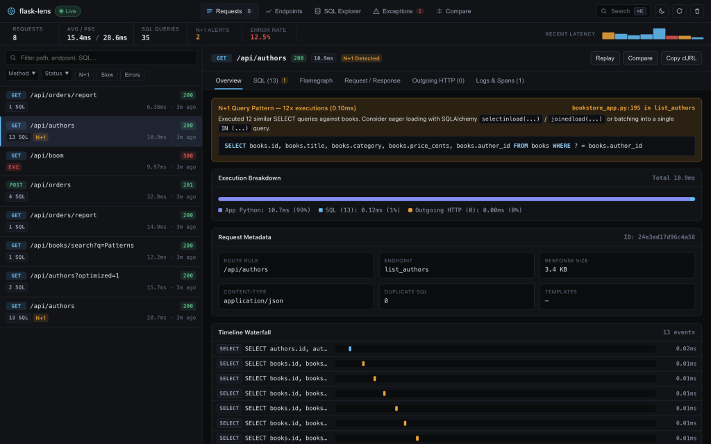
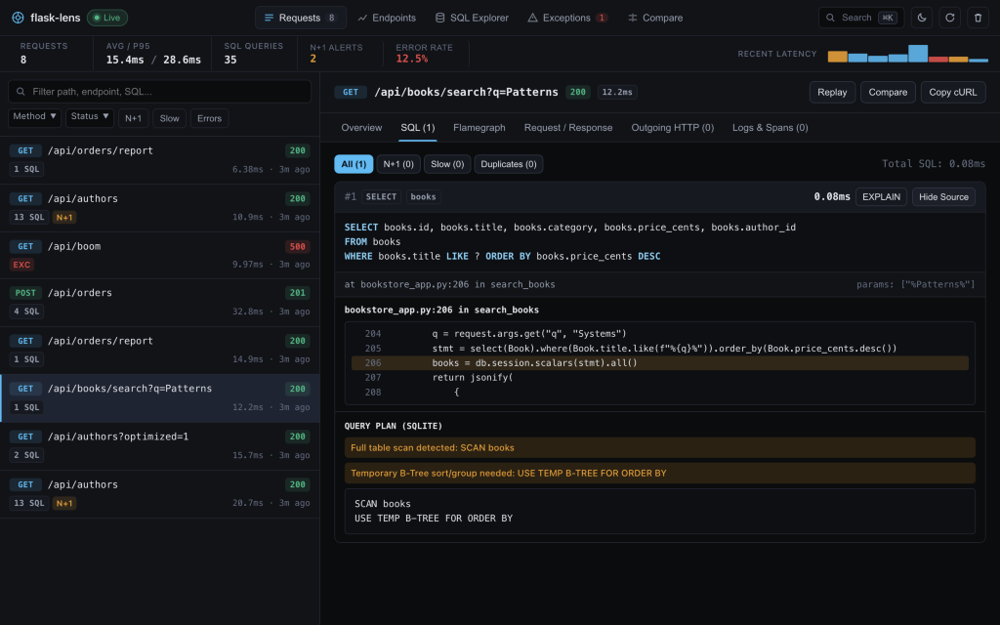
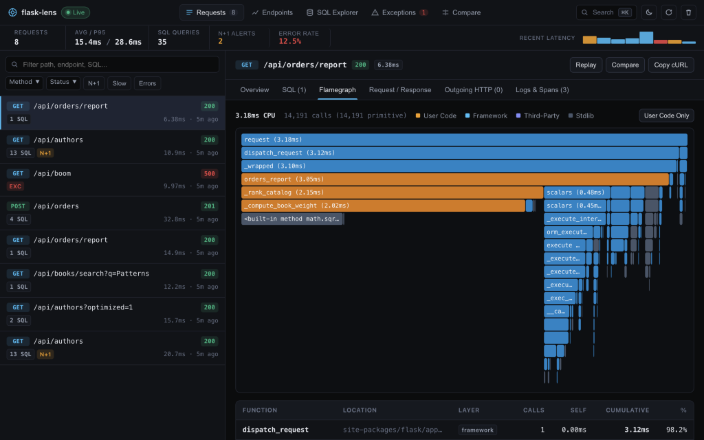
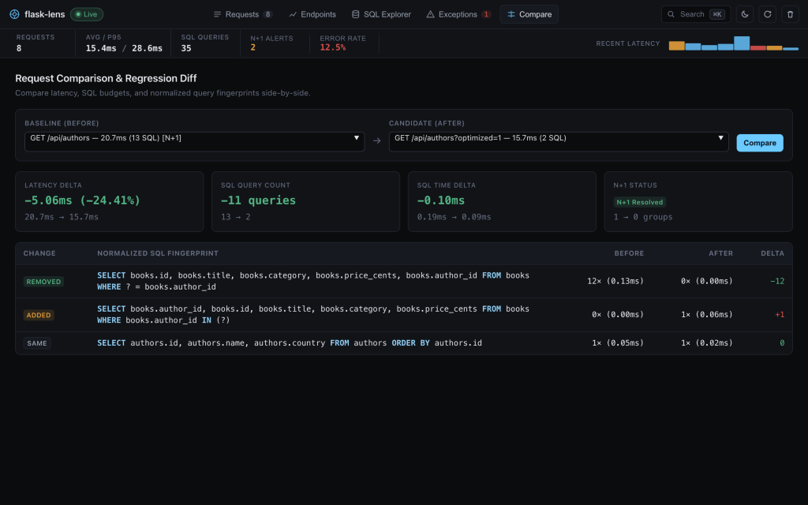
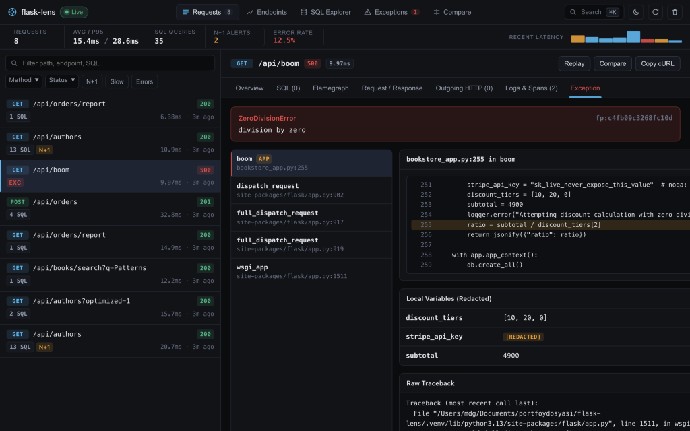
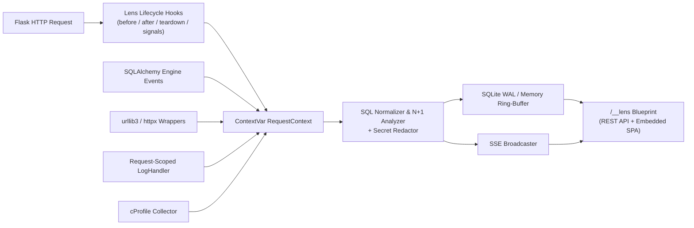

# flask-lens

[](https://github.com/duhanguler/flask-lens/actions/workflows/ci.yml)
[](https://www.python.org/downloads/)
[](src/flask_lens/py.typed)
[](LICENSE)

**Real-time developer observability, SQL/N+1 profiler, EXPLAIN analyzer, cProfile flamegraph, request replayer, and Django-style `assertNumQueries` guardrails for Flask — in two lines of code.**

Mount `Lens(app, db=db)` to open a zero-dependency DevTools console at `/__lens` that works across **JSON REST APIs, HTMX, webhooks, SPAs, and server-rendered HTML**.



---

## Why `flask-lens`?

Django ships `assertNumQueries` in core and has `django-silk` for persistent SQL and Python profiling; Laravel has Telescope. In Flask, `Flask-DebugToolbar` only injects a sidebar into `text/html` responses — leaving REST APIs, SPAs, redirects, and background webhooks blind and losing history on every request.

| Capability | `flask-lens` | `Flask-DebugToolbar` | `django-silk` / Django |
| :--- | :---: | :---: | :---: |
| Works on JSON APIs, HTMX & Webhooks | Yes | No (HTML only) | Yes |
| Persistent request history & live SSE stream | Yes (SQLite WAL / Memory) | No | Yes (DB tables) |
| Automatic SQL N+1 & duplicate detection with `file:line` | Yes | Duplicate count only | Manual inspection |
| Safe read-only `EXPLAIN` + full-table-scan warnings | Yes | SQLite/PG basic | Yes |
| Per-request `cProfile` interactive SVG flamegraph | Yes | Flat table only | cProfile graph |
| Outgoing HTTP (`requests`/`urllib3`/`httpx`), logs & custom spans | Yes | Logs only | Partial |
| Interactive Request Replay + Before/After Diff comparator | Yes | No | No |
| `assert_num_queries` / `@pytest.mark.no_n_plus_one` CI guardrails | Yes (built-in pytest plugin) | No | `assertNumQueries` |
| External infrastructure required | **None** | None | Database migrations |

---

## Installation

```bash
pip install flask-lens
```

`flask-lens` depends **only on `flask` and `werkzeug`**. SQLAlchemy, Flask-SQLAlchemy, `requests`, and `httpx` integrations activate automatically when installed:

```bash
pip install "flask-lens[flask-sqlalchemy]"
```

---

## Two-Line Quickstart

### Direct initialization

```python
from flask import Flask
from flask_sqlalchemy import SQLAlchemy
from flask_lens import Lens

app = Flask(__name__)
app.config["SQLALCHEMY_DATABASE_URI"] = "sqlite:///app.db"

db = SQLAlchemy(app)
lens = Lens(app, db=db)  # Console available at http://127.0.0.1:5000/__lens
```

### Application factory pattern

```python
from flask import Flask
from flask_sqlalchemy import SQLAlchemy
from flask_lens import Lens

db = SQLAlchemy()
lens = Lens()


def create_app() -> Flask:
    app = Flask(__name__)
    app.config["SQLALCHEMY_DATABASE_URI"] = "sqlite:///app.db"
    db.init_app(app)
    lens.init_app(app, db=db)
    return app
```

### Run the interactive bookstore demo

Clone the repo and fire pre-built N+1, eager-load, full-table-scan, CPU flamegraph, secret redaction, and exception scenarios in seconds:

```bash
git clone https://github.com/duhanguler/flask-lens.git
cd flask-lens
uv venv && uv pip install -e ".[dev]"
python examples/bookstore_app.py
# Open http://127.0.0.1:5050/ and http://127.0.0.1:5050/__lens
```

---

## Feature Tour

### 1. SQL Inspector, Source Context & One-Click `EXPLAIN`

Every SQLAlchemy query is canonicalized into a normalized fingerprint, tagged for **N+1**, **duplicate**, and **slow** behavior, and mapped back to your exact application source line. Clicking **EXPLAIN** runs a read-only `EXPLAIN` / `EXPLAIN QUERY PLAN` (strictly rejecting mutating or multi-statement SQL) and highlights full table scans (`SCAN` / `Seq Scan`) and temporary sorts (`USE TEMP B-TREE` / `filesort`).



### 2. Interactive `cProfile` SVG Flamegraph

Inspect per-request CPU hotspots with a zoomable SVG flamegraph and flat function table color-coded by layer (**User Code**, **Framework**, **Third-Party**, **Stdlib**). Control profiling scope via `profile_mode` (`"always"`, `"slow"`, `"on_demand"`, `"off"`), the `@lens.profile` view decorator, or the `X-Lens-Profile: 1` request header.



### 3. Request Replay & Before/After Diff Comparator

Edit headers, query parameters, or JSON payloads directly inside `/__lens`, replay the request against your live Flask app, and compare **Before vs After** latency, SQL query count, N+1 resolution status, and normalized SQL fingerprint diffs side by side.



### 4. Structured Exception Inspector with Secret Redaction

Unhandled exceptions are captured in both `debug`/`testing` and production modes with clickable stack frames, source context lines, and a local-variable table where sensitive keys (`password`, `token`, `api_key`, `secret`, `Authorization`, `Cookie`, etc.) are automatically scrubbed to `[REDACTED]`.



---

## Django `assertNumQueries` & Pytest Guardrails

Lock in SQL query budgets and catch N+1 regressions directly in CI — without writing boilerplate SQLAlchemy event listeners:

```python
import pytest
from flask_lens import assert_max_queries, assert_no_n_plus_one, assert_num_queries


def test_authors_endpoint(client, db):
    with assert_num_queries(db, 2):
        resp = client.get("/api/authors?optimized=1")
        assert resp.status_code == 200

    with assert_no_n_plus_one(db, threshold=3):
        client.get("/api/authors?optimized=1")


# Or declaratively via the auto-registered pytest11 plugin:
@pytest.mark.max_queries(2)
@pytest.mark.no_n_plus_one
def test_authors_declarative(client, db):
    assert client.get("/api/authors?optimized=1").status_code == 200
```

See [docs/testing-guardrails.md](docs/testing-guardrails.md) for fixtures, custom thresholds, and failure reports.

---

## Custom Spans, Events & `Server-Timing`

Annotate business logic on the request waterfall with zero ceremony:

```python
@app.post("/api/orders")
@lens.profile  # Profile even when profile_mode="on_demand"
def create_order():
    with lens.span("payment.authorize", provider="stripe") as meta:
        charge = authorize_payment()
        meta["charge_id"] = charge.id

    lens.event("order.created", {"amount_cents": 4900})
    return jsonify({"ok": True}), 201
```

Every captured response also emits a standard W3C `Server-Timing` header so timings appear natively in Chrome DevTools:

```http
Server-Timing: total;dur=10.90, sql;dur=0.12;desc="13 queries"
X-Lens-Request-Id: 24e3ed17d96c4a58
```

---

## Flask CLI Integration

`flask-lens` registers a `flask lens` command group automatically:

```bash
flask lens status                     # Active config, watched engines, stored counts
flask lens stats --limit 15           # Per-endpoint p50/p95/p99 latency, SQL & N+1 table
flask lens slow --limit 10            # Top normalized SQL fingerprints by total time
flask lens export report.json         # Export full telemetry snapshot for bug reports
flask lens clear                      # Wipe stored ring-buffer telemetry
```

---

## Measured Overhead Benchmarks

Measured locally with [`benchmarks/bench_overhead.py`](benchmarks/bench_overhead.py) (CPython 3.13, macOS Apple Silicon, 300 iterations after 30 warmup iterations per scenario):

| Scenario | JSON Route (`/ping`) Mean | JSON Delta | SQLAlchemy Route (`/items`) Mean | SQLAlchemy Delta |
| :--- | ---: | ---: | ---: | ---: |
| Plain Flask (baseline) | `0.090 ms` | baseline | `0.202 ms` | baseline |
| `Lens(enabled=False)` | `0.084 ms` | `~0.000 ms` | `0.200 ms` | `~0.000 ms` |
| `Lens(storage="memory", profile_mode="off")` | `0.147 ms` | `+0.057 ms` | `0.375 ms` | `+0.172 ms` |
| `Lens(storage="sqlite", profile_mode="off")` | `0.249 ms` | `+0.159 ms` | `0.604 ms` | `+0.401 ms` |
| `Lens(storage="sqlite", profile_mode="always")` | `1.302 ms` | `+1.212 ms` | `6.339 ms` | `+6.137 ms` |

Reproduce on your hardware with `make bench`. For high-traffic staging runs, set `profile_mode="on_demand"` or `profile_mode="slow"` to keep request capture under **0.4 ms**.

---

## Architecture



---

## Security & Production Guidance

- **Access Control:** Gate `/__lens` outside localhost using `authorize=lambda req: ...`.
- **Automatic Redaction:** Sensitive headers (`Authorization`, `Cookie`, `Set-Cookie`, `X-API-Key`), JSON/form fields, SQL bind parameters, and exception locals are redacted to `[REDACTED]` by default before persistence.
- **Safe `EXPLAIN`:** Strictly limited to single, read-only `SELECT` statements; mutating DML/DDL and multi-statement queries are rejected.
- **Safe Replay:** Restricted to relative application paths; `/__lens` routes and external URLs are rejected to prevent recursion and SSRF.

Read [docs/configuration.md](docs/configuration.md) and [SECURITY.md](SECURITY.md) for full details.

---

## Development

```bash
make install   # Create .venv via uv and install dev dependencies
make check     # ruff lint + format check + mypy --strict + pytest coverage
make bench     # Run reproducible WSGI overhead benchmarks
make build     # Build wheel & sdist via hatchling
```

## License

MIT — see [LICENSE](LICENSE).
